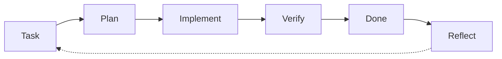

<div align="center">


**An Agile Agentic Coding Harness**

**Version 1.10.0** ·   

[🇬🇧 English](README.md) · [Loslegen](#loslegen) · [Warum STEM](#warum-stem) · [Ablauf](#ablauf) · [Inhalt](#inhalt)

</div>

STEM gibt deinem Coding-Agenten einen gemeinsamen Ablauf: ein Projekt einrichten, Arbeit mit [Backlog.md](https://github.com/MrLesk/Backlog.md) verfolgen und Entscheidungen zwischen Sitzungen bewahren. STEM setzt auf dem Coding-Agenten auf, den du schon nutzt (Claude Code oder Codex), und folgt dessen Änderungen mit versionierten Releases.

## Loslegen

1. [ZIP herunterladen](https://github.com/Akku/stem/archive/refs/heads/main.zip) und entpacken. Den ganzen Ordner einschließlich versteckter Dateien verwenden.
2. Diesen Ordner in deinem Coding-Agenten öffnen (zum Beispiel in der Claude-Desktop-App, Tab Code).
3. Diesen Prompt einfügen und den Platzhalter durch deine Idee ersetzen:

```text
Richte dieses Projekt ein: Folge SETUP.md. Arbeite in meiner Sprache und installiere alles, was fehlt, selbst (ich genehmige die Schritte).

Was ich entwickeln will, ist folgendes:
<deine Idee: was, für wen, woran erkennt man „fertig“ – ein paar Sätze>
```

Beantworte die Rückfragen des Agenten und genehmige nötige Installationsschritte. Er richtet mit dir Werkzeuge, Vision, Meilensteine und erste Tasks ein. Installer-Passwörter nur im Installer eingeben, nie im Chat.

**Technisch Versierte:** auf GitHub **Use this template** wählen oder das Repository klonen, dann derselbe Prompt. Die [ausführliche Anleitung](STARTE_HIER.md) bietet weitere Hilfe.

<details>
<summary>Teststand der Agenten und Plattformen</summary>

Claude Code ist im praktischen Einsatz getestet. Codex ist durch einen automatisierten Testlauf getestet (Einrichtung eines neuen Projekts, native Skill-Liste, Abstimmungsgespräch, eine Aufgabe bis Done) sowie in einem bestehenden Projekt mit dokumentierten Umgehungslösungen; Projekt-Hooks, die Codex-Oberfläche, Codex Cloud und das Verhalten bei langem Kontext sind nicht abgedeckt. Die [Codex-Hinweise](docs/agent/CODEX.md) erklären Voraussetzungen, Sitzungsstart, Sandbox-Zugriff und das Vorgehen ohne Kontextwarnung (Agentenhinweise auf Englisch).

macOS ist getestet; Windows ist vorbereitet, aber noch nicht getestet.

</details>

## Warum STEM

1. **Geführter Start.** Du beschreibst deine Idee; der Agent installiert und erklärt die Werkzeuge (Git, Node.js, Backlog.md) und erarbeitet mit dir Vision, Meilensteine und die ersten Tasks.
2. **Kontinuität.** Jede Sitzung endet mit einer kurzen Übergabenotiz, die nächste beginnt mit einem Zustandsüberblick. So geht die Arbeit dort weiter, wo sie aufgehört hat, statt bei null.
3. **Lernen.** Kurze Retrospektiven machen aus gemessener Reibung Regeländerungen in deinem Projekt; Erkenntnisse, die sich bewähren, fließen als versionierte Releases zurück in STEM.
4. **Nachvollziehbarkeit.** Jede Änderung läuft über einen Task mit Akzeptanzkriterien und festgehaltenen Belegen. Du siehst, was der Agent getan hat und warum es als fertig gilt.

Außerdem: darauf ausgelegt, den Kontext des Agenten klein zu halten (Regeln werden bei Bedarf geladen, lange Logs bleiben aus dem Chat), und ein Pre-Commit-Schutz verhindert, dass `.env`-Dateien und gängige API-Token-Formate committet werden.

## Für wen

- **Einzelentwickler mit eigenen Ideen:** Du bringst die Idee mit; der Agent führt mit dir Vision, Meilensteine und Backlog, damit die Idee viele Sitzungen übersteht.
- **Teams mit Firmen-Abo für einen Coding-Agenten:** STEM braucht kein zusätzliches Konto, keinen Server und kein weiteres Abo. Es läuft im Agenten, den deine Firma schon bezahlt, und seine Regeln und Aufzeichnungen sind einfache Dateien in deinem Repository.
- **Eigenes Abo, Arbeit für eine andere Firma:** STEM steht unter MIT-Lizenz. Ob dein Agenten-Abo für diese Arbeit genutzt werden darf, regeln die Bedingungen deines Anbieters und der Firma; prüfe sie vor dem Start.

**Warum nicht nur Claude?** Jeder unterstützte Agent liest dieselben Regeln (`AGENTS.md`), dasselbe Backlog und dieselbe Übergabenotiz; der Projektstand hängt also nicht an einem Agenten. Codex ist bei einer neuen Einrichtung und in einem bestehenden STEM-Projekt getestet.

## Wann STEM nicht passt

Für Einmal-Skripte und Teams mit eigenem Prozess siehe [STEM oder der Agent pur?](#stem-oder-der-agent-pur).

- Du willst volle Automatisierung ohne Freigaben.
- Projekte, in denen Git oder Backlog.md nicht nutzbar sind.
- Du willst, dass eine KI dein Projekt ohne dich führt. Die Geschichte kennen wir; für den Menschen endet sie nicht gut.

`[ You ]──▶[ STEM ]──▶[ More YOU ]`

## Ablauf

Die Idee wird zuerst zu einer Spezifikation geschärft (Spec-Driven Development), danach läuft jede Änderung durch dieselbe nachvollziehbare Schleife, und das Harness lernt aus jeder Runde.



Reflect ist der Skill `retro`: Learnings fließen ins Harness zurück (und, wenn bewährt, in STEM).

## Prinzipien

- Informationsarchitektur statt „kürzer antworten": kurze Einstiege, Vertiefung nach Bedarf, Volllogs außerhalb des Kontexts.
- Eine verbindliche Quelle je Regel; Adapter verweisen nur.
- Das Harness wächst durch Retros, nicht durch Vorrat (`R-DECISION`).

## Aktuell bleiben

Zu Beginn jeder Sitzung prüft der Agent (einmal pro Tag), ob es eine neuere STEM-Version gibt, und sagt dir Bescheid. Mit deiner Zustimmung liest der Skill `stem-update` das [Changelog](CHANGELOG.md), wählt aus, was deinem Projekt nützt, und übernimmt es, ohne projektspezifische Inhalte zu überschreiben. Auch der Skill `retro` prüft STEM.

STEM-Releases tragen Versionsnummern nach dem Muster `MAJOR.MINOR.PATCH`; Umbenennungen und Entfernungen stehen mit Migrationshinweis im Changelog. Dein Projekt hat eine eigene Version, beginnend bei 0.1.0, unabhängig von der STEM-Version in `STEM_VERSION`: Nach einem abgeschlossenen Arbeitspaket schlägt der Agent einen Patch-, Minor- oder Major-Sprung vor und setzt ihn nur mit deiner Zustimmung um.

## STEM oder der Agent pur?

Coding-Agenten wie Claude Code oder Codex funktionieren auch allein gut. STEM legt einen Arbeitsablauf darum, und der kostet zusätzliche Schritte. Eine grobe Orientierung:

| Deine Situation | Agent pur | Mit STEM |
| --- | --- | --- |
| Einmal-Skript oder schneller Prototyp | Reicht meist | Setup und Task-Schritte kosten mehr, als sie bringen |
| Ein Projekt über viele Sitzungen | Du erklärst den Stand neu oder führst eigene Notizen | Übergabenotiz und Zustandsüberblick, in der nächsten Sitzung automatisch gelesen |
| Du hast keinen technischen Hintergrund | Du installierst und konfigurierst die Werkzeuge selbst | Der Agent installiert und erklärt die Werkzeuge; eine Freigabe pro Installationsschritt |
| Du willst sehen, was der Agent getan hat und ob es fertig ist | Du liest den Chat und die Änderungen | Ein Task mit Akzeptanzkriterien und Nachweisen; eine Prüfung pro Task |
| Dein Setup soll mit der Zeit besser werden | Änderungen passieren nebenbei | Retros machen aus Reibung Regeländerungen; alle paar Tasks eine Retro |
| Ein Team mit eigenem Prozess, eigener CI und Review | Der Agent fügt sich in euren Prozess | Der STEM-Prozess würde euren doppeln; passt nicht |

Getestete Agenten und Plattformen: siehe *Teststand der Agenten und Plattformen* unter [Loslegen](#loslegen).

**Andere Ansätze.** Mehrere Open-Source-Projekte geben Coding-Agenten ebenfalls Struktur; die Stärken überschneiden sich.

- **Spec-first-Werkzeuge** (zum Beispiel [Spec Kit](https://github.com/github/spec-kit), [OpenSpec](https://github.com/Fission-AI/OpenSpec)): stark darin, jede Änderung vor dem Code in eine abgestimmte Spezifikation, einen Plan und Tasks zu fassen. STEM schärft die Idee einmal beim Setup und legt den Schwerpunkt auf die projektweite Schleife aus Backlog, Übergabe und Retro.
- **Skill-Bibliotheken** (zum Beispiel [Superpowers](https://github.com/obra/superpowers)): stark in der Engineering-Disziplin pro Arbeitspaket, etwa Entwurf, testgetriebene Entwicklung, Review und Verifikation. STEM schreibt diese Engineering-Schritte nicht vor; sein Schwerpunkt ist die Kontinuität über Sitzungen.
- **Rollenbasierte agile Methoden** (zum Beispiel [BMad Method](https://github.com/bmad-code-org/BMAD-METHOD)): stark in strukturierter Planung mit Rollen-Agenten, Backlog und Retrospektiven; am nächsten an STEM. STEM ist kleiner und richtet das geführte Setup auf Menschen ohne technischen Hintergrund aus.

Stand laut eigener Dokumentation der Projekte, November 2026; diese Projekte ändern sich schnell.

## Inhalt

<details>
<summary>Alle Dateien anzeigen</summary>

| Datei | Zweck |
| --- | --- |
| `STARTE_HIER.md` / `START_HERE.md` | Anleitung für Menschen (DE/EN) |
| `.claude/skills/` | Skills: `retro`, `alignment`, `handoff`, `promote-learning`, `stem-update`; optionale Module (Auswahl beim Setup): `testing-practices`, `market-analysis` |
| `.agents/skills` | Verweis auf `.claude/skills/` für gemeinsame Codex-Skill-Quellen; Codex listet diese Skills nativ (automatisierter Testlauf) |
| `.claude/agents/` | Agenten: `ux-designer` (optionales Modul, für Projekte mit Oberfläche) |
| `SETUP.md` | Einmalige Setup-Anleitung für den Agenten (wird nach dem Setup gelöscht) |
| `AGENTS.md` | Gemeinsame Kernregeln (Codex & kompatible Tools) |
| `CLAUDE.md` | Dünner Adapter, verweist auf `AGENTS.md` |
| `scripts/githooks/pre-commit` | Schutz vor dem Committen vertraulicher Quelldokumente und gängiger Secrets (wird beim Setup aktiviert) |
| `STEM_VERSION`, `CHANGELOG.md` | STEM-Version, auf der das Projekt basiert; Änderungen je Version |
| `.claude/settings.json` | Claude Code: sichere Befehle vorab freigegeben, Sitzungsstart-Hook |
| `LICENSE` | MIT (STEM); `.github/stem-check.py` + Workflow prüfen STEM selbst |
| `scripts/check-backlog.sh`, `scripts/retro-metrics.sh`, `scripts/promote-check.sh` | Backlog-Konsistenzprüfung (auch im Pre-commit-Hook); Messwerte für Retros; Learnings, die STEM teilen kann |
| `docs/agent/stacks/` | Stack-spezifische Hinweise, nur bei passendem Stack geladen |
| `scripts/context-report.py` | Optionales Retro-Werkzeug (Claude Code): wohin der Kontext floss, längste Sitzungen; nur Zahlen |
| `scripts/context-check.py` | Claude-Code-Hook: warnt bei großem Kontext, dass eine neue Sitzung fällig ist |
| `scripts/run.sh` | Kompakte Ausgabe für Tests/CI/CLI (Exitcode bleibt erhalten, Volllog im git-ignorierten `.agent-logs/`, `evidence:`-Verweis für Task-Notizen; nicht zitierte Logs älter als 30 Tage werden gelöscht) |
| `scripts/session-start.sh` | Zustandsüberblick zum Sitzungsstart (Branch, Änderungen, Tasks, Übergabe); ändert keine Projektdateien, `STEM_OFFLINE=1` ohne Netzwerk |
| `docs/agent/OPERATING_MODEL.md` | Regeln mit stabilen IDs (`R-*`), gezielt per ID geladen |
| `docs/agent/ADVANCED.md` | Selten gebrauchte Regeln (Parallelität, Messung, Routing, lokale Modelle) |
| `docs/agent/EXPERIMENTS.md` | Hypothesen, Messgrößen, Basislinien und Evidenzgrade für dauerhaft kostenwirksame Regeln |
| `docs/agent/NEXT_RETRO.md` | Alles für die nächste Retro an einem Ort: fällige Prüfungen, Beobachtungen, Punkte für die erste Retro |
| `docs/agent/PITFALLS.md` | Wachsende Liste technischer Stolperfallen |
| `docs/agent/PROCESS_IMPROVEMENTS.md` | Retro-Behandlung und Rückfluss in STEM |

</details>

## Beitragen

Bewährte Learnings aus Projekten bitte per Pull Request einbringen (Muster: Problem, Muster, Geltungsbereich, Evidenz – siehe `docs/agent/PROCESS_IMPROVEMENTS.md`). Keine Projekt- oder Firmeninterna, keine Zugangsdaten – das Repository ist öffentlich. Ablauf und Checkliste (englisch): [CONTRIBUTING.md](CONTRIBUTING.md).

*Der Name ist eine Anspielung auf das KI-Implantat im Film [Upgrade](https://www.imdb.com/title/tt6499752/) (2018).*
