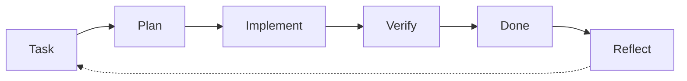

**An Evolving Agentic Coding Harness** – Du behältst die Kontrolle; dein Agent behält den Faden und lernt aus jeder Runde.

`[ you ]──▶[ STEM ]──▶[ more you ]`

**Version 1.5.0** ·    

🇬🇧 **English version: [README.md](README.md)**

[Warum STEM](#warum-stem) · [Loslegen](#loslegen) · [Wann es nicht passt](#wann-stem-nicht-passt) · [Ablauf](#ablauf) · [Updates](#aktuell-bleiben) · [Inhalt](#inhalt)

STEM ist ein Harness für die Arbeit mit einem Coding-Agenten. Ein Harness ist der Rahmen um den Agenten: Regeln, Skills (Schritt-für-Schritt-Anleitungen für wiederkehrende Aufgaben) und kleine Skripte, die steuern, wie er mit dir arbeitet. Du öffnest den STEM-Ordner in deinem Agenten (zum Beispiel Claude Code), beschreibst dein Ziel, und der Agent arbeitet mit Git und [Backlog.md](https://github.com/MrLesk/Backlog.md) Task für Task.

**Teststand der Agenten:** Claude Code ist im praktischen Einsatz getestet. Codex ist in einem bestehenden Projekt mit dokumentierten Umgehungslösungen getestet; die Einrichtung eines neuen Projekts und die native Skill-Erkennung sind noch nicht nachgewiesen. Für GitHub Copilot gibt es einen Adapter; er ist noch ungetestet.

*Der Name ist eine Anspielung auf das KI-Implantat im Film [Upgrade](https://www.imdb.com/title/tt6499752/) (2018). Anders als dort behältst du hier die Kontrolle.*

## Warum STEM

1. **Geführter Start.** Du beschreibst deine Idee; der Agent installiert und erklärt die Werkzeuge (Git, Node.js, Backlog.md) und erarbeitet mit dir Vision, Meilensteine und die ersten Tasks.
2. **Kontinuität.** Jede Sitzung endet mit einer kurzen Übergabenotiz, die nächste beginnt mit einem Zustandsüberblick. So geht die Arbeit dort weiter, wo sie aufgehört hat, statt bei null.
3. **Lernen.** Kurze Retrospektiven machen aus gemessener Reibung Regeländerungen in deinem Projekt; Erkenntnisse, die sich bewähren, fließen als versionierte Releases zurück in STEM.
4. **Nachvollziehbarkeit.** Jede Änderung läuft über einen Task mit Akzeptanzkriterien und festgehaltenen Belegen. Du siehst, was der Agent getan hat und warum es als fertig gilt.

Außerdem: darauf ausgelegt, den Kontext des Agenten klein zu halten (Regeln werden bei Bedarf geladen, lange Logs bleiben aus dem Chat), und ein Pre-Commit-Schutz verhindert, dass `.env`-Dateien und gängige API-Token-Formate committet werden.

## Loslegen

1. [ZIP herunterladen](https://github.com/Akku/stem/archive/refs/heads/main.zip) und entpacken.
2. Den Ordner in deinem Coding-Agenten öffnen (zum Beispiel in der Claude-Desktop-App, Tab Code).
3. Den Prompt aus [STARTE_HIER.md](STARTE_HIER.md) geben.

Der Agent installiert dann fehlende Werkzeuge gemeinsam mit dir, richtet Git und Backlog.md ein, hilft dir, die Idee in Vertical Slice, MVP und Moonshot zu schärfen, passt das Harness an dein Ziel an und legt Backlog.md-Meilensteine und erste Tasks an. macOS ist getestet; Windows ist vorbereitet, aber noch nicht getestet.

**Technisch Versierte:** auf GitHub **Use this template** wählen oder das Repository klonen, dann derselbe Prompt.

Pro Sitzung führt der Agent `scripts/session-start.sh` aus (kurzer Zustandsüberblick).

**Mit Codex:** [Codex-Hinweise](docs/agent/CODEX.md) beschreiben Werkzeugvoraussetzungen, manuellen Sitzungsstart, Sandbox-Zugriff und das Vorgehen ohne Kontextwarnung (Agentenhinweise auf Englisch).

## Wann STEM nicht passt

- Einmal-Skripte und Wegwerf-Prototypen: Der Aufwand übersteigt den Nutzen; nimm den Agenten pur.
- Teams mit eigenem Prozess, eigener CI und Review-Kultur.
- Du willst volle Automatisierung ohne Freigaben.
- Projekte, in denen Git oder Backlog.md nicht nutzbar sind.
- Du willst, dass eine KI dein Projekt ohne dich führt. Die Geschichte kennen wir; für den Menschen endet sie nicht gut.

## Ablauf

Die Idee wird zuerst zu einer Spezifikation geschärft (Spec-Driven Development), danach läuft jede Änderung durch dieselbe nachvollziehbare Schleife, und das Harness lernt aus jeder Runde.

Reflect ist der Skill `retro`: Learnings fließen ins Harness zurück (und, wenn bewährt, in STEM).

## Aktuell bleiben

Zu Beginn jeder Sitzung prüft der Agent (einmal pro Tag), ob es eine neuere STEM-Version gibt, und sagt dir Bescheid. Mit deiner Zustimmung liest der Skill `stem-update` das [Changelog](CHANGELOG.md), wählt aus, was deinem Projekt nützt, und übernimmt es, ohne projektspezifische Inhalte zu überschreiben. Auch der Skill `retro` prüft STEM.

## Start-Prompt

Gib dies dem Agenten, nachdem du den Ordner geöffnet hast:

> Richte dieses Projekt ein: Folge `SETUP.md`. Arbeite in meiner Sprache und installiere alles, was fehlt, selbst (ich genehmige die Schritte). Was ich entwickeln will, ist folgendes: *<deine Idee: was, für wen, woran erkennt man „fertig“ – ein paar Sätze>*

## Inhalt

Alle Dateien anzeigen

| Datei | Zweck |
| --- | --- |
| `STARTE_HIER.md` / `START_HERE.md` | Anleitung für Menschen (DE/EN) |
| `.claude/skills/` | Skills: `retro`, `alignment`, `handoff`, `promote-learning`, `stem-update`; optionale Module (Auswahl beim Setup): `testing-practices`, `market-analysis` |
| `.agents/skills` | Verweis auf `.claude/skills/` für gemeinsame Codex-Skill-Quellen; native Erkennung noch nicht nachgewiesen |
| `.claude/agents/` | Agenten: `ux-designer` (optionales Modul, für Projekte mit Oberfläche) |
| `SETUP.md` | Einmalige Setup-Anleitung für den Agenten (wird nach dem Setup gelöscht) |
| `AGENTS.md` | Gemeinsame Kernregeln (Codex & kompatible Tools) |
| `CLAUDE.md` / `.github/copilot-instructions.md` | Dünne Adapter, verweisen auf `AGENTS.md` |
| `scripts/githooks/pre-commit` | Schutz vor dem Committen vertraulicher Quelldokumente und gängiger Secrets (wird beim Setup aktiviert) |
| `STEM_VERSION`, `CHANGELOG.md` | STEM-Version, auf der das Projekt basiert; Änderungen je Version |
| `.claude/settings.json` | Claude Code: sichere Befehle vorab freigegeben, Sitzungsstart-Hook |
| `LICENSE` | MIT (STEM); `.github/stem-check.py` + Workflow prüfen STEM selbst |
| `scripts/check-backlog.sh`, `scripts/retro-metrics.sh`, `scripts/promote-check.sh` | Backlog-Konsistenzprüfung (auch im Pre-commit-Hook); Messwerte für Retros; Learnings, die STEM teilen kann |
| `docs/agent/stacks/` | Stack-spezifische Hinweise, nur bei passendem Stack geladen |
| `scripts/context-report.py` | Optionales Retro-Werkzeug (Claude Code): wohin der Kontext floss, längste Sitzungen; nur Zahlen |
| `scripts/context-check.py` | Claude-Code-Hook: warnt bei großem Kontext, dass eine neue Sitzung fällig ist |
| `scripts/run.sh` | Kompakte Ausgabe für Tests/CI/CLI (Exitcode bleibt erhalten, Volllog im git-ignorierten `.agent-logs/`, `evidence:`-Verweis für Task-Notizen) |
| `scripts/session-start.sh` | Zustandsüberblick zum Sitzungsstart (Branch, Änderungen, Tasks, Übergabe); ändert keine Projektdateien, `STEM_OFFLINE=1` ohne Netzwerk |
| `docs/agent/OPERATING_MODEL.md` | Regeln mit stabilen IDs (`R-*`), gezielt per ID geladen |
| `docs/agent/ADVANCED.md` | Selten gebrauchte Regeln (Parallelität, Messung, Routing, lokale Modelle) |
| `docs/agent/EXPERIMENTS.md` | Hypothesen, Messgrößen, Basislinien und Evidenzgrade für dauerhaft kostenwirksame Regeln |
| `docs/agent/NEXT_RETRO.md` | Alles für die nächste Retro an einem Ort: fällige Prüfungen, Beobachtungen, Punkte für die erste Retro |
| `docs/agent/PITFALLS.md` | Wachsende Liste technischer Stolperfallen |
| `docs/agent/PROCESS_IMPROVEMENTS.md` | Retro-Behandlung und Rückfluss in STEM |

## Prinzipien

- Informationsarchitektur statt „kürzer antworten": kurze Einstiege, Vertiefung nach Bedarf, Volllogs außerhalb des Kontexts.
- Eine verbindliche Quelle je Regel; Adapter verweisen nur.
- Das Harness wächst durch Retros, nicht durch Vorrat (`R-DECISION`).

## Beitragen

Bewährte Learnings aus Projekten bitte per Pull Request einbringen (Muster: Problem, Muster, Geltungsbereich, Evidenz – siehe `docs/agent/PROCESS_IMPROVEMENTS.md`). Keine Projekt- oder Firmeninterna, keine Zugangsdaten – das Repository ist öffentlich. Ablauf und Checkliste (englisch): [CONTRIBUTING.md](CONTRIBUTING.md).
