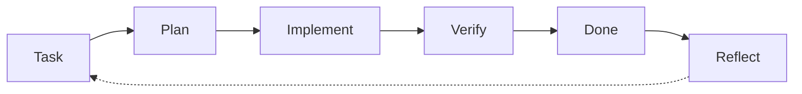

<div align="center">


**An Evolving Agentic Coding Harness**

**Version 1.8.0** ·   

[🇩🇪 Deutsch](README.de.md) · [Get started](#get-started) · [Why STEM](#why-stem) · [How it works](#how-it-works) · [Contents](#contents)

</div>

STEM gives your coding agent a shared workflow for setting up a project, tracking work with [Backlog.md](https://github.com/MrLesk/Backlog.md), and carrying decisions between sessions.

## Get started

1. [Download the ZIP](https://github.com/Akku/stem/archive/refs/heads/main.zip) and unzip it. Keep the whole folder, including hidden files.
2. Open that folder in your coding agent (for example the Claude desktop app, Code tab).
3. Paste this prompt, replacing the placeholder with your idea:

```text
Set up this project: follow SETUP.md. Work in my language and install anything that is missing yourself (I will approve the steps).

What I want to build is the following:
<your idea: what, for whom, what "done" looks like – a few sentences>
```

Answer the agent's questions and approve installation steps as needed. It sets up the tools, vision, milestones and first tasks with you. Type installer passwords only into the installer, never into the chat.

**Technical users:** click **Use this template** on GitHub, or clone the repository, then use the same prompt. [Detailed setup guide](START_HERE.md) for more help.

<details>
<summary>Agent and platform test status</summary>

Claude Code is tested in real use. Codex is tested by an automated probe run (fresh setup, native skill listing, alignment interview, one task to Done) and in an existing project with documented workarounds; project hooks, the Codex UI, Codex Cloud and long-context behaviour are not covered. See [Codex mechanics](docs/agent/CODEX.md) for prerequisites, session start, sandbox access and the context-warning fallback.

macOS is tested; Windows is prepared but not yet tested.

</details>

## Why STEM

1. **Guided start.** You describe your idea; the agent installs and explains the tools (Git, Node.js, Backlog.md) and works out with you a vision, milestones and the first tasks.
2. **Continuity.** Each session ends with a short handoff note and the next one starts with a state summary, so work picks up where it stopped instead of starting from zero.
3. **Learning.** Short retrospectives turn measured friction into rule changes in your project; learnings that prove themselves flow back into STEM as versioned releases.
4. **Traceability.** Every change runs through a task with acceptance criteria and recorded evidence, so you can see what the agent did and why it counts as done.

Also: designed to keep the agent's context small (rules load on demand, long logs stay out of the chat), and a pre-commit guard blocks `.env` files and common API-token formats from being committed.

## When STEM does not fit

For one-off scripts and teams with their own process, see [STEM or the plain agent?](#stem-or-the-plain-agent).

- You want full automation without approvals.
- Projects where Git or Backlog.md cannot be used.
- You want an AI to run your project without you. We've seen that story; it doesn't end well for the human.

`[ You ]──▶[ STEM ]──▶[ More YOU ]`

## How it works

The idea is sharpened into a spec first (spec-driven development), then every change runs through the same traceable loop, and the harness learns from each round.



Reflect is the `retro` skill: learnings flow back into the harness (and, once proven, into STEM).

## Principles

- Information architecture over "answer shorter": short entry points, deeper detail on demand, full logs outside the context.
- One authoritative source per rule; adapters only point to it.
- The harness grows through retros, not by stockpiling (`R-DECISION`).
- Humans read English/German docs; agent instructions are English; agents talk to users in the user's language.

## Staying up to date

At the start of each session the agent checks (once per day) whether a newer STEM version exists and tells you. With your approval the `stem-update` skill reads the [changelog](CHANGELOG.md), picks what helps your project and merges it without overwriting your project-specific content. The `retro` skill checks STEM as well.

## STEM or the plain agent?

Coding agents such as Claude Code or Codex work well on their own. STEM adds a workflow around them, and that workflow costs extra steps. A rough guide:

| Your situation | Plain agent | With STEM |
| --- | --- | --- |
| One-off script or quick prototype | Usually enough | Setup and task steps cost more than they bring |
| A project over many sessions | You re-explain the state or keep your own notes | Handoff note and state summary, read automatically in the next session |
| You have no technical background | You install and configure the tools yourself | The agent installs and explains the tools; one approval per installation step |
| You want to see what the agent did and whether it is done | You read the chat and the changes | A task with acceptance criteria and evidence; one check per task |
| You want your setup to improve over time | Changes happen ad hoc | Retros turn friction into rule changes; a retro every few tasks |
| A team with its own process, CI and review | The agent fits into your process | STEM's process would duplicate yours; not a fit |

Tested agents and platforms: see *Agent and platform test status* under [Get started](#get-started).

**Other approaches.** Several open-source projects add structure to coding agents too; strengths overlap.

- **Spec-first toolkits** (for example [Spec Kit](https://github.com/github/spec-kit), [OpenSpec](https://github.com/Fission-AI/OpenSpec)): strong at turning each change into an agreed spec, plan and tasks before code is written. STEM sharpens the idea once at setup and focuses on the project-wide loop of backlog, handoff and retro.
- **Skill libraries** (for example [Superpowers](https://github.com/obra/superpowers)): strong at engineering discipline per piece of work, such as design, test-driven development, review and verification. STEM does not prescribe these engineering steps; its focus is continuity across sessions.
- **Role-based agile methods** (for example [BMad Method](https://github.com/bmad-code-org/BMAD-METHOD)): strong at structured planning with role agents, a backlog and retrospectives; the closest to STEM. STEM is smaller and aims its guided setup at people without a technical background.

Based on each project's own documentation as of November 2026; these projects change quickly.

## Contents

<details>
<summary>Show all files</summary>

| File | Purpose |
| --- | --- |
| `START_HERE.md` / `STARTE_HIER.md` | Human guide (EN/DE) |
| `SETUP.md` | One-time setup procedure for the agent (deleted after setup) |
| `AGENTS.md` | Shared core rules (Codex and compatible tools) |
| `CLAUDE.md` | Thin adapter pointing to `AGENTS.md` |
| `.claude/skills/` | Skills: `retro`, `alignment`, `handoff`, `promote-learning`, `stem-update`; optional modules (chosen in setup): `testing-practices`, `market-analysis` |
| `.agents/skills` | Link to `.claude/skills/` for shared Codex skill sources; Codex lists these skills natively (automated probe) |
| `.claude/agents/` | Agents: `ux-designer` (optional module, for projects with a UI) |
| `scripts/githooks/pre-commit` | Guard against committing confidential source documents and common secrets (activated during setup) |
| `STEM_VERSION`, `CHANGELOG.md` | STEM version this project is based on; what changed per version |
| `.claude/settings.json` | Claude Code: safe commands pre-approved, session-start hook |
| `LICENSE` | MIT (STEM); `.github/stem-check.py` + workflow check STEM itself |
| `scripts/check-backlog.sh`, `scripts/retro-metrics.sh`, `scripts/promote-check.sh` | Backlog consistency check (also in the pre-commit hook); measured evidence for retros; learnings ready to share with STEM |
| `docs/agent/stacks/` | Stack-specific notes, loaded only when the stack applies |
| `scripts/context-report.py` | Optional retro tool (Claude Code): where the context went, longest sessions; numbers only |
| `scripts/context-check.py` | Claude Code hook: warns when the context is large and a new session is due |
| `scripts/run.sh` | Compact output for tests/CI/CLI (exit code preserved, full log in git-ignored `.agent-logs/`, `evidence:` pointer for task notes) |
| `scripts/session-start.sh` | Session start summary (branch, changes, tasks, handoff); changes no project files, `STEM_OFFLINE=1` for no network |
| `docs/agent/OPERATING_MODEL.md` | Rules with stable IDs (`R-*`), loaded selectively |
| `docs/agent/ADVANCED.md` | Rarely needed rules (parallelism, measurement, routing, local models) |
| `docs/agent/EXPERIMENTS.md` | Hypotheses, metrics, baselines and evidence grades for cost-carrying rules |
| `docs/agent/NEXT_RETRO.md` | Everything the next retro needs in one place: due checks, observations, first-retro items |
| `docs/agent/PITFALLS.md` | Growing list of technical pitfalls |
| `docs/agent/PROCESS_IMPROVEMENTS.md` | Retro handling and feeding learnings back into STEM |

</details>

## Contributing

Please contribute proven learnings via pull request (pattern: problem, pattern, applicability, evidence – see `docs/agent/PROCESS_IMPROVEMENTS.md` or the `promote-learning` skill). No project or company internals, no credentials – this repository is public. Details and checklist: [CONTRIBUTING.md](CONTRIBUTING.md).

*The name is a nod to the AI implant in the film [Upgrade](https://www.imdb.com/title/tt6499752/) (2018).*
