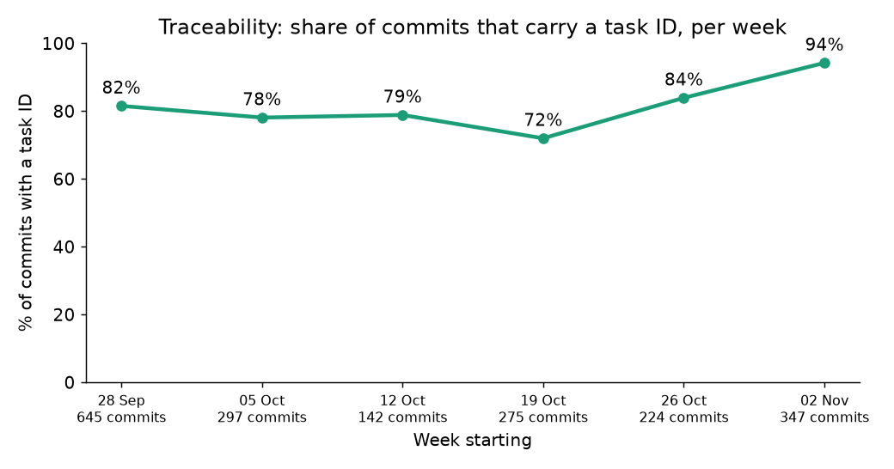
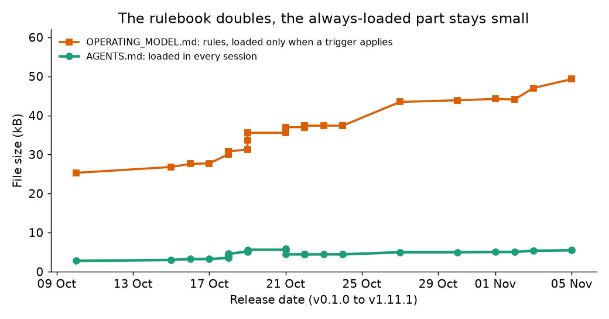
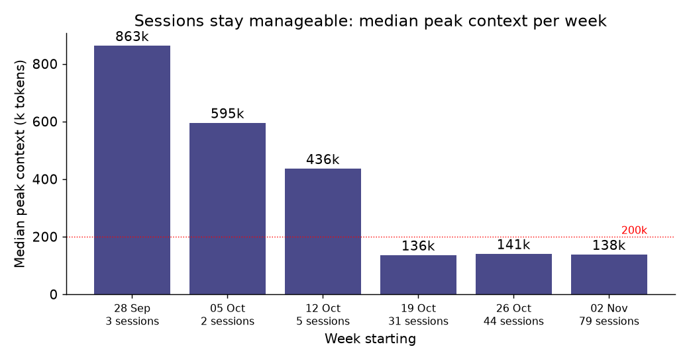

# Results from using STEM on itself

Three curves from the author's own work. They are **dogfooding data, not a benchmark**: 164 Claude Code sessions in 11 projects, one user, 2026-10-03 to 2026-11-05, no control group without STEM. Numbers only; no project names or session content. A controlled comparison (STEM vs. a plain agent) is planned as experiment G2 in [EXPERIMENTS.md](agent/EXPERIMENTS.md).

## 1. Traceability: commits that carry a task ID

Between 72 % and 94 % of all commits reference a backlog task, in every week, and the latest week is the highest (94 %). A commit with a task ID can be traced to a goal, a plan and evidence lines. Time windows tie commits to sessions, so the figures are approximate.

## 2. The rulebook grows, the always-loaded part does not

From v0.1.0 to v1.11.1 the rules file roughly doubled (25 kB to 49 kB), but `AGENTS.md`, the only file loaded in every session, stays at about 5 kB (roughly 1.5k tokens). Rules are loaded by ID when their trigger applies. Sizes are taken from the release tags.

## 3. Sessions stay manageable

The median peak context of a session fell from several hundred thousand tokens in the first weeks to about 140k since 2026-10-19 (the earlier weeks rest on 2 to 5 sessions each). The handoff rule (start a new session by about 100k) and the context notice are the intended cause, but this data cannot prove it; session habits changed too.

## What these curves do not show

- Not a with/without comparison, and not generalised beyond one user.
- Not fewer model calls per task: that figure stayed flat in the same period.
- The start context of a session (about 58k at the start, about 74k now) is mostly Claude Code itself, global settings and tools, not STEM.
